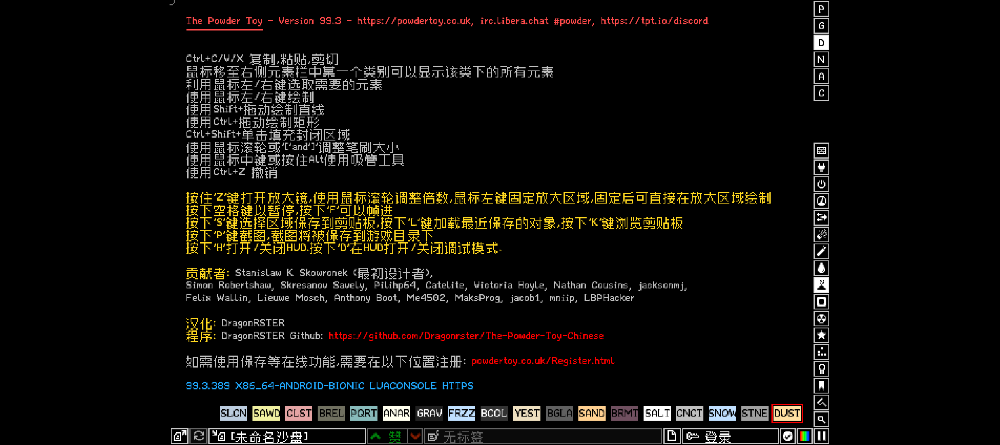

# 粉末游戏 · Android 特化版

**The Powder Toy（粉末游戏）的 Android 特化版本。**

原版 [The Powder Toy](https://github.com/The-Powder-Toy/The-Powder-Toy) 是 C++ / SDL2 写的开源物理沙盒游戏
（GPL-3.0），社区一直没有能直接用 Android Studio 编译打包的工程。本项目把它——以及社区简体中文汉化分支
[The-Powder-Toy-Chinese](https://github.com/Dragonrster/The-Powder-Toy-Chinese)——接进 Android Studio，
并针对手机做了编译期与运行期优化。

## 下载

到 [Releases](https://github.com/jxb01/ThePowderToy-Android/releases) 直接下 APK：

| 包 | 说明 |
| --- | --- |
| PowderToy-zhCN-… | 简体中文汉化版，应用名「粉末游戏」 |
| PowderToy-official-… | 原版英文 |

两者包名不同（uk.co.powdertoy.tpt.zhcn / uk.co.powdertoy.tpt），**可以装在同一台手机上**。
需要 Android 7.0（API 24）及以上，支持 arm64-v8a 和 x86_64。

## 与上游的关系

| 角色 | 项目 | 协议 |
| --- | --- | --- |
| **原版（粉末游戏）** | [The-Powder-Toy/The-Powder-Toy](https://github.com/The-Powder-Toy/The-Powder-Toy) | GPL-3.0 |
| 简体中文汉化 | [Dragonrster/The-Powder-Toy-Chinese](https://github.com/Dragonrster/The-Powder-Toy-Chinese) | GPL-3.0 |
| **本项目** | Android 构建管线 + 手机优化 + 打包 | GPL-3.0 |

本仓库**不含游戏源码**（没有 src/），也**不修改游戏内核**，只做 Android 侧的构建与优化。
游戏著作权归上游作者，汉化文本与中文字体归汉化分支作者 DragonRSTER。

## 从源码构建

需要 Windows + PowerShell 7、Android Studio（含 SDK）、Python 3.8+。

~~~powershell
# 1. 建工程内的 meson/ninja 环境并检查 NDK
.\scripts\bootstrap.ps1

# 2. 交叉编译原生库（首次会自动下载 tpt-libs 预编译静态库）
.\scripts\build-native.ps1 -Abis arm64-v8a,x86_64 -Lto

# 3. 打包
.\gradlew.bat :app:assembleRelease
~~~

装到设备：

~~~powershell
.\scripts\install.ps1 -Launch
~~~

* 只要真机包：加 -PtptAbis=arm64-v8a
* 换上游源码目录：加 -PtptSource=D:/path/to/The-Powder-Toy
* 用 Android Studio：直接 Open 本目录，点 Run 之前要先做完第 2 步

### 汉化版

~~~powershell
.\scripts\build-native.ps1 -Abis arm64-v8a,x86_64 -Lto ^
    -SourceDir <汉化分支源码目录> ^
    -JniLibsDir app/src/main/jniLibs-zhcn -BuildTag zhcn

.\gradlew.bat :app:assembleRelease -PtptZhcn=true
~~~

## 做了什么

* **Android 构建管线** —— 上游 meson 工程接入 Gradle，用 NDK 编出 libpowder.so，再交给 AGP 打包签名。
* **编译期** —— -O3、ThinLTO、--gc-sections；16 KB 内存页对齐（Android 15+ 必需）；strip。
* **打包** —— .so 不压缩、页对齐直载，冷启动不用解压；关闭 R8（Java 层靠 JNI 名字回调，混淆会崩）。
* **运行期** —— 申请屏幕最高刷新率、最小后处理、largeHeap、横屏双向、后台不熄屏、自适应图标。
* **一份代码两个包** —— -PtptZhcn=true 切换官方版 / 汉化版。

更细的构建差异、优化明细和踩坑记录见 **[docs/BUILD-NOTES.md](docs/BUILD-NOTES.md)**。

## 授权

[GPL-3.0](LICENSE)。
