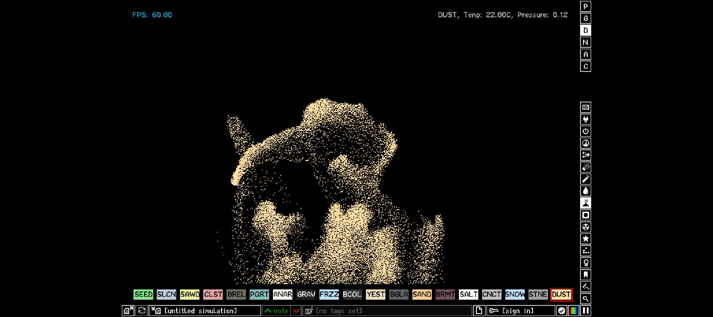

# 构建笔记

这些是维护时才需要看的细节。上手请先读 [README](../README.md)。

## 目录结构

~~~
ThePowderToy-Android/
├── app/                                  Android 应用模块
│   ├── build.gradle.kts                  打包 / 签名 / ABI / 版本变体
│   ├── libs/sdl2.jar                     SDL2 的 Java 层（编译原生库时自动同步）
│   └── src/main/{AndroidManifest.xml,java,res,jniLibs}
├── scripts/
│   ├── bootstrap.ps1                     工程内 meson/ninja 虚拟环境 + NDK
│   ├── build-native.ps1                  交叉编译 libpowder.so
│   ├── make-keystore.ps1                 生成固定开发签名
│   ├── make-icons.py                     生成各密度启动图标
│   └── install.ps1                       adb 装机
├── docs/                                 截图与本文件
├── build/native/<abi>-<type>/            meson 构建目录
├── build/native/symbols/<abi>/           未 strip 的 .so（查崩溃用）
└── gradle/, gradlew, gradlew.bat, *.gradle.kts
~~~

上游源码不复制进本仓库，默认位置通过 tptSourceDir 或 -PtptSource 指定。

## 环境要求

* Android Studio（自带 JBR 当 JDK）
* Android SDK：platform-tools、build-tools、platforms（任意一个 android.jar，脚本会借用）
* Android NDK：脚本自动安装 27.2.12479018（r27c LTS）
* Python 3.8+（只用来建 meson 虚拟环境，meson/ninja 装在工程内，不动系统 Python）
* Windows + PowerShell 7

## 签名

仓库里故意不放 keystore，release 包签名按这个顺序决定：

1. -PtptKeystore=xxx.jks（配合 -PtptStorePass / -PtptKeyAlias / -PtptKeyPass）
2. 工程根目录的 tpt-dev.jks
3. 都没有 → 退回 AGP 自动生成的 debug 签名

第 3 种情况能编能装，但换机器或清掉 debug.keystore 后签名会变，覆盖安装会报
INSTALL_FAILED_UPDATE_INCOMPATIBLE。想避免就跑 scripts/make-keystore.ps1。
生成的 tpt-dev.jks 在 .gitignore 里。

## 和上游构建的差异

1. **只编 libpowder.so，不编 APK。** 上游 android/meson.build 用 aapt2/d8/apksigner 自己撸 APK，
   这套流程和 Android Studio 冲突。这里只用 meson 产 .so，剩下的交给 AGP。
2. **直接用 NDK 的 clang++.exe 加 --target=aarch64-linux-android21**，
   绕开 aarch64-linux-android21-clang++.cmd 那层批处理包装（meson 在 Windows 上对 .cmd 处理不稳）。
3. **android_platform 取 tpt-libs 声明的值。** meson 会拿它跟 tpt-libs 里写死的值比对，
   不一致直接报 platform mismatch。脚本会自动从 subprojects/tpt-libs-prebuilt-*-android-* 里读出来。
   android_platform_jar 只在 meson 配置期当字符串收下（不走打包那条路），借用本机任意 android.jar 即可。
4. **不要加 -Wl,--exclude-libs,ALL。** SDL2 的 JNI 入口
   （Java_org_libsdl_app_SDLActivity_nativeGetVersion 等）实现于 libSDL2.a，
   一旦把静态库符号从动态符号表抹掉，再叠加 --gc-sections 会被整个回收，
   Java 侧一调用就抛 UnsatisfiedLinkError，启动即崩。

## 优化明细

### 编译期（原生库）

| 优化 | 说明 |
| --- | --- |
| -O3 | 上游 CI 用 debugoptimized（-O2），这里用 release |
| ThinLTO | -Lto 打开，跨编译单元内联 |
| -ffunction-sections / -fdata-sections + --gc-sections | 丢死代码 |
| -Wl,-O2 | 链接期优化 |
| -Wl,-z,max-page-size=16384 | 16 KB 内存页对齐，Android 15+ 有 16 KB 页的设备必须 |
| -ffast-math 等 | 上游 release 就开了，粒子模拟收益明显 |
| llvm-strip --strip-unneeded | 去调试符号；未 strip 版本留在 build/native/symbols/ |
| x86_64 只开 SSE2 | 模拟器 CPU 特性不可控，上 SSE4/AVX 会非法指令 |
| -ArmArch v8.2 / v8.4（可选） | 多开 dotprod/crc/crypto；2019 年前的老机会非法指令，默认关 |

### 打包期

| 优化 | 说明 |
| --- | --- |
| jniLibs.useLegacyPackaging = false | .so 不压缩、页对齐直载，冷启动不用解压到 /data |
| 关闭 R8 / 资源裁剪 | Java 层只有薄薄一层 SDL 胶水，靠 JNI 名字回调，混淆会崩；省下的空间相对原生库可忽略 |

### 运行期

| 优化 | 说明 |
| --- | --- |
| 申请最高刷新率 | 读 Display.getSupportedModes()，把 preferredRefreshRate 顶到最高档。模拟仍限 60 FPS，但高刷屏上触摸到出画的延迟更低 |
| preferMinimalPostProcessing | 让合成器少做一层后处理，压低显示延迟 |
| largeHeap + hardwareAccelerated | 给模拟和资源留足堆 |
| sensorLandscape | 横屏两个方向都支持 |
| configChanges 补全 density / fontScale 等 | 改字体、折叠屏展开不会重启 Activity |
| FLAG_KEEP_SCREEN_ON | 长时间挂着看不中途熄屏 |
| 深色全屏主题 + windowBackground | 启动不闪白 |
| 自适应图标 + 五档密度图标 | 上游只有一张 mdpi 图标 |
| 触屏 UI 默认开启 | 上游 android 平台本就打开 DEFAULT_TOUCH_UI |

### 关于 GPU / NPU / AI 加速

真机上有 Hexagon NPU、联发科 APU、Edge TPU 这类加速器，但它们帮不上这个项目：

* NPU / NNAPI 只吃规整的张量算子。本作的模拟核心是逐格子的整数元胞自动机
  （读几个邻居、按元素规则分支），是访存加分支密集，不是矩阵乘；改写成张量运算要么不可能，
  要么每帧主机与 NPU 同步的开销就吃掉全部收益。
* 瓶颈在 CPU 不在 GPU：每帧是在 CPU 上算完粒子、写进纹理再由 GPU 贴出来，
  GPU 只负责最后那次 blit，换 Vulkan 也不会更快。

所以优化全落在让 CPU 少干活、让系统少挡路上。

## 汉化版

汉化用社区完整汉化分支 [The-Powder-Toy-Chinese](https://github.com/Dragonrster/The-Powder-Toy-Chinese)
的 v99.3.389 源码树，改了 682 个源文件，并换了一套带中文字形的 TPT 位图字体
（resources/font.bz2 380 KB，上游只有 57 KB，由 resources/zpix.bdf 用 fonttool.py 生成）。

| 项 | 官方版 | 汉化版 |
| --- | --- | --- |
| applicationId | uk.co.powdertoy.tpt | uk.co.powdertoy.tpt.zhcn |
| 应用名 | The Powder Toy | 粉末游戏 |
| 版本 | 100.1.400 | 99.3.389 |
| 原生库目录 | app/src/main/jniLibs | app/src/main/jniLibs-zhcn |

注意：

* 汉化分支停在 v99.3.389（2025 年初），比上游 100.1.400 旧。
* 汉化用的 tpt-libs vtag 与上游不同，脚本会自动从源码的 .wrap 里读。
* 应用名走 resValue 生成（AGP 9 需在 buildFeatures 里打开 resValues），
  res/values/strings.xml 里不要再写 app_name，否则资源重名。

## 常见问题

**Gradle 报「缺少原生库」** —— 原生库还没编，先跑 build-native.ps1。

**启动闪退，日志是 UnsatisfiedLinkError: nativeGetVersion** —— 链接参数里混进了 --exclude-libs。

**mergeReleaseJniLibFolders 报 libpowder.so Duplicate resources** ——
sourceSets 里用了 jniLibs.srcDir(...)（追加）。必须用 setSrcDirs(listOf(...))（替换），
否则默认的 src/main/jniLibs 和新目录会同时被收进去。

**脚本报「已为命令多次定义名为 Debug 的参数」** ——
参数不能叫 -Debug，[CmdletBinding()] 已自带同名公共参数，改用 -DebugBuild。

**meson 报 tpt-libs android platform mismatch** —— tpt-libs 的 vtag 变了。
脚本会自动读实际值；若 subprojects 下还没解压，先跑一次让它解压，再跑第二次。

**tpt-libs 下载太慢** —— 手动下好 zip 放进 subprojects/packagecache/，文件名和 SHA256 见 .wrap 文件。

## 还能做的

* ABI 分包上架（-PtptAbis 已能只出单 ABI 包，再挂 splits 即可）
* 在 SDL surface 上调 setFrameRate，对齐 120 Hz 屏幕
* 开 -Wl,--icf=all 试试更小体积（脚本里是 -Icf 开关，默认关）
